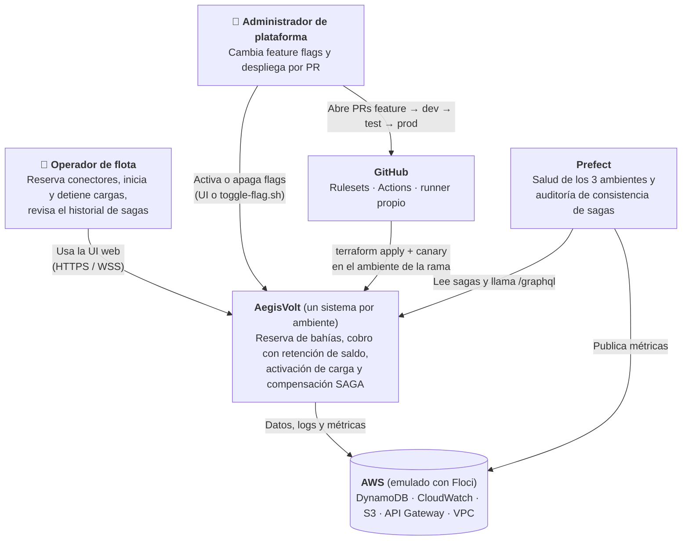
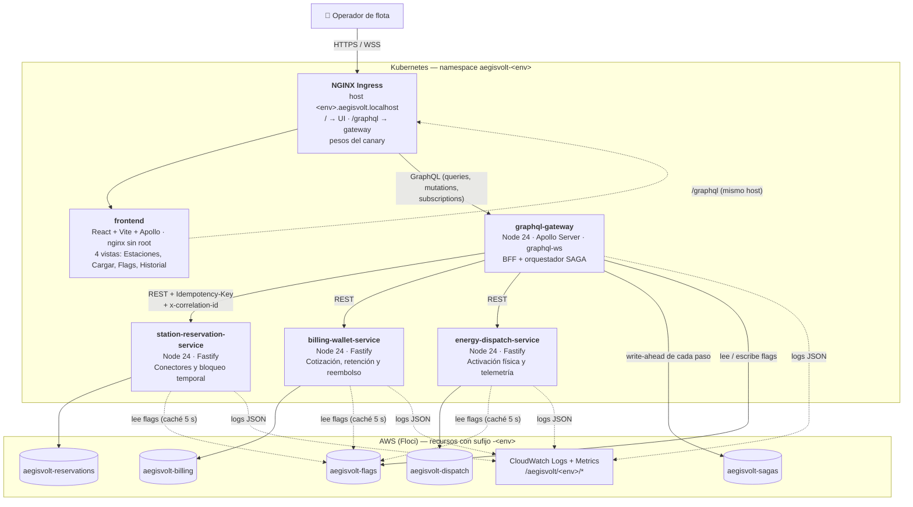
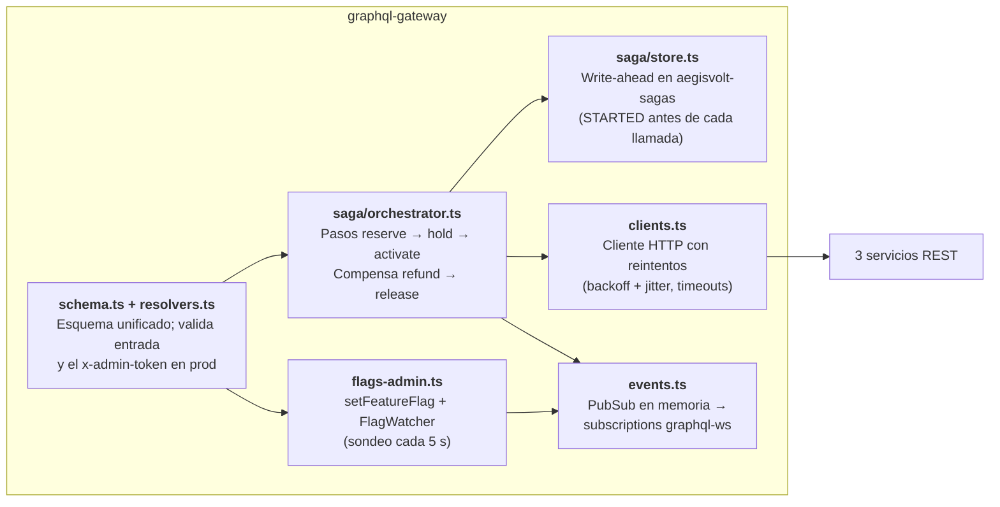
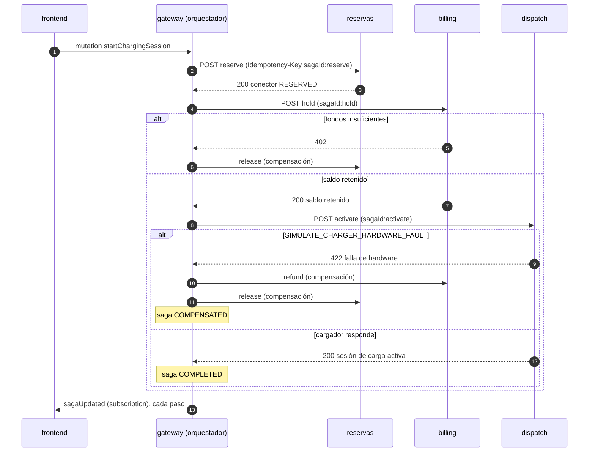
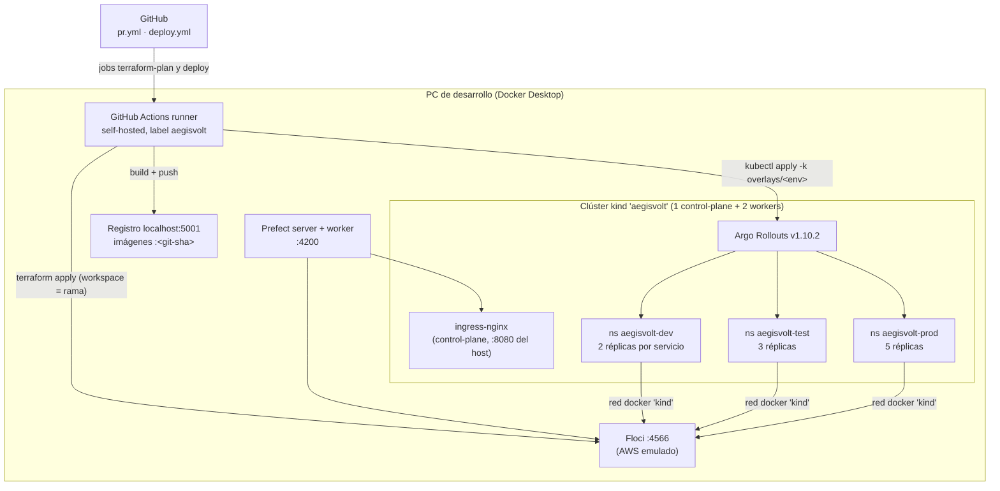

# Arquitectura de AegisVolt

Diagramas en notación C4, dibujados con Mermaid (GitHub los muestra directamente). Cada ambiente (`dev`, `test` y `prod`) es una copia completa e independiente de lo que muestran los niveles 1 a 3.

## 1. Vista de contexto (C4 nivel 1)

Quién usa AegisVolt y con qué sistemas externos habla.



## 2. Vista de contenedores (C4 nivel 2)

Las piezas desplegables de un ambiente. En kind, todas corren en el namespace `aegisvolt-<env>`.



Cada servicio es dueño de su tabla (*Database-per-Service*): nadie lee la tabla de otro. El gateway solo es dueño de `sagas` y `flags`.

| Contenedor | Tecnología | Datos propios |
|---|---|---|
| Frontend (panel de operación) | React + Vite + Apollo · nginx sin root | — (habla solo GraphQL con el gateway, mismo host; ver [frontend.md](frontend.md)) |
| API Gateway HTTP API (stage = env) | AWS APIGW v2 | Access logs `/aegisvolt/<env>/apigateway` |
| graphql-gateway (BFF + orquestador SAGA) | Node 24 · Apollo | `aegisvolt-sagas-<env>`, `aegisvolt-flags-<env>` (lectura/escritura) |
| station-reservation-service | Node 24 · Fastify | `aegisvolt-reservations-<env>` |
| billing-wallet-service | Node 24 · Fastify | `aegisvolt-billing-<env>` |
| energy-dispatch-service | Node 24 · Fastify | `aegisvolt-dispatch-<env>` |

### 2.1 Componentes del gateway (C4 nivel 3)

El contenedor con más lógica es el gateway, porque además de BFF es el orquestador de la SAGA ([ADR-0002](adr/0002-saga-orquestada-en-gateway.md)).



Reglas del orquestador:
- **Pasos:** 3 intentos, solo ante fallos transitorios (5xx o timeout).
- **Errores de negocio:** un 402 (fondos insuficientes), 409 (conector ocupado) o 422 (falla de hardware) es definitivo. No se reintenta y se compensa directamente.
- **Compensaciones:** hasta 6 intentos. Si se agotan, la saga queda en `COMPENSATING`, y la auditoría de Prefect la reporta.

### 2.2 La SAGA "Reservar y Activar Carga"



### 2.3 Despliegue (C4)



El gateway tiene 1 réplica en cada ambiente, porque el PubSub de las subscriptions está en memoria ([ADR-0005](adr/0005-graphql-bff-y-rest-interno.md)).

## 3. Red por ambiente (Terraform: `infra/modules/network`, `vpc-endpoints`, `api-gateway`)

| Ambiente | VPC | Subredes públicas | Subredes privadas |
|---|---|---|---|
| dev | 10.10.0.0/16 | 10.10.0.0/20, 10.10.16.0/20 | 10.10.128.0/20, 10.10.144.0/20 |
| test | 10.20.0.0/16 | 10.20.0.0/20, 10.20.16.0/20 | 10.20.128.0/20, 10.20.144.0/20 |
| prod | 10.30.0.0/16 | 10.30.0.0/20, 10.30.16.0/20 | 10.30.128.0/20, 10.30.144.0/20 |

```
 Internet
    │ HTTPS
    ▼
 ┌──────────────────────────────┐
 │ API Gateway HTTP API         │  stage "<env>", throttling, access logs JSON
 └──────────────┬───────────────┘
                │ integración HTTP_PROXY, connection_type = VPC_LINK
 ═══════════════╪════════════════ VPC aegisvolt-vpc-<env> ═══════════════════════
                ▼
   ENIs del VPC Link (subredes PRIVADAS) ── SG sg-vpclink: egress 80 → VPC
                │
                ▼
   NLB interno aegisvolt-nlb-<env> :80 (sin IP pública)
                │  target group (target_type = ip)
                ▼
   NGINX Ingress Controller (pods) ── SG sg-k8s-nodes: ingress 80 SOLO desde sg-vpclink
                │  regla Ingress /graphql
                ▼
   Service ClusterIP graphql-gateway ──kube-proxy──► Pod graphql-gateway
                │  REST interno (ClusterIP)
                ▼
   Pods de station-reservation / billing-wallet / energy-dispatch
                │
   ┌────────────┴───────────────┬───────────────────────────────┐
   ▼                            ▼                               ▼
 Gateway VPCE dynamodb     Gateway VPCE s3              Interface VPCE logs / monitoring / sts
 (route table privada:     (route table privada:        (ENIs privadas + DNS privado,
  prefix list pl-xxxx)      prefix list pl-yyyy)         SG sg-vpce: 443 desde la VPC)
   │ política: solo
   │ aegisvolt-*-<env>
   ▼
 DynamoDB del ambiente
```

### Recorrido de un paquete (pregunta 6.1)

1. **Cliente → API Gateway.** El cliente envía HTTPS al endpoint público `https://<api-id>.execute-api.us-east-1.amazonaws.com/<env>/graphql`. API Gateway termina TLS, aplica throttling y escribe el access log.
2. **API Gateway → VPC Link.** La ruta `POST /graphql` tiene una integración `HTTP_PROXY` con `connection_type = VPC_LINK`. API Gateway entrega el paquete a las **ENIs del VPC Link**, que viven en las **subredes privadas** y llevan el SG `sg-vpclink`. La salida solo se permite al puerto 80 dentro del CIDR de la VPC.
3. **VPC Link → NLB interno.** El destino de la integración es el *listener* del NLB interno. La **route table privada** resuelve el tráfico con la ruta `local` (dentro de la VPC). No existe ruta `0.0.0.0/0`, así que nada puede salir a internet.
4. **NLB → Ingress.** El NLB reenvía al *target group* tipo `ip`, donde Kubernetes registra los pods del NGINX Ingress. El SG `sg-k8s-nodes` **solo acepta el puerto 80 desde `sg-vpclink`**.
5. **Ingress → Pod.** NGINX enruta `/graphql` al Service ClusterIP `graphql-gateway`, y kube-proxy lo entrega a un pod sano (readiness probe en `/health`). Durante un canary, Argo Rollouts reparte el tráfico entre el Service estable y el canary por peso.
6. **Pod → DynamoDB.** El SDK resuelve `dynamodb.us-east-1.amazonaws.com`. La route table privada tiene la **prefix list de DynamoDB** que apunta al **Gateway VPCE**, y la **política del endpoint** solo permite tablas `aegisvolt-*-<env>`. El tráfico no sale de la red de AWS.
7. **Pod → CloudWatch Logs.** `logs.us-east-1.amazonaws.com` resuelve, gracias al DNS privado, a las IPs de las ENIs del **Interface VPCE logs**. El SG `sg-vpce` permite 443 desde la VPC.

### Componentes que intervienen

| Elemento | Dónde | Qué controla |
|---|---|---|
| `aegisvolt-rt-private-<env>` | route table privada | Sin ruta a internet; prefix lists S3/DynamoDB → Gateway VPCE |
| `aegisvolt-rt-public-<env>` | route table pública | `0.0.0.0/0 → IGW` (solo subredes públicas) |
| `sg-vpclink` | ENIs del VPC Link | Egress 80 → CIDR de la VPC |
| `sg-k8s-nodes` | nodos/Ingress | Ingress 80 **solo desde sg-vpclink** y tráfico interno entre nodos |
| `sg-vpce` | Interface VPCE | Ingress 443 desde la VPC |
| Política del VPCE DynamoDB | Gateway VPCE | Solo tablas `aegisvolt-*-<env>` |

> **Implementado vs. emulado:** todos los recursos de la tabla existen en el estado de Terraform de cada workspace (`terraform state list`). En Floci no hay enrutamiento físico de la VPC. El tráfico real de la demo ocurre dentro de kind: Ingress → Service → Pod. Ver ADR-0001.

## 4. Datos (DynamoDB, Database-per-Service)

| Tabla | Claves | Extras |
|---|---|---|
| `aegisvolt-reservations-<env>` | `PK=STATION#id`, `SK=META \| CONNECTOR#id` | TTL `expiresAt` (bloqueos temporales) |
| `aegisvolt-billing-<env>` | `PK=WALLET#fleet`, `SK=META \| TX#sagaId` | — |
| `aegisvolt-dispatch-<env>` | `PK=SESSION#sagaId`, `SK=META \| TS#iso` | TTL `expiresAt` (telemetría) |
| `aegisvolt-sagas-<env>` | `PK=SAGA#correlationId`, `SK=META` | GSI `status-updatedAt-index` (detección de huérfanas) |
| `aegisvolt-flags-<env>` | `PK=FLAG#name`, `SK=META` | Seed por `tfvars`, `ignore_changes` (toggle en caliente) |

En `prod`: `deletion_protection_enabled` y Point-in-Time Recovery activos.

## 5. Observabilidad

- Log groups: `/aegisvolt/<env>/{graphql-gateway, station-reservation-service, billing-wallet-service, energy-dispatch-service, apigateway}`. Retención: dev 7 días, test 14, prod 30.
- Metric filters (namespace `AegisVolt/<env>`):
  - `ServiceErrors`: `level = "error"`.
  - `Http5xx`: `statusCode >= 500`, con dimensiones Service y Version. Lo usa el análisis del canary.
  - `SagaCompensated`.
